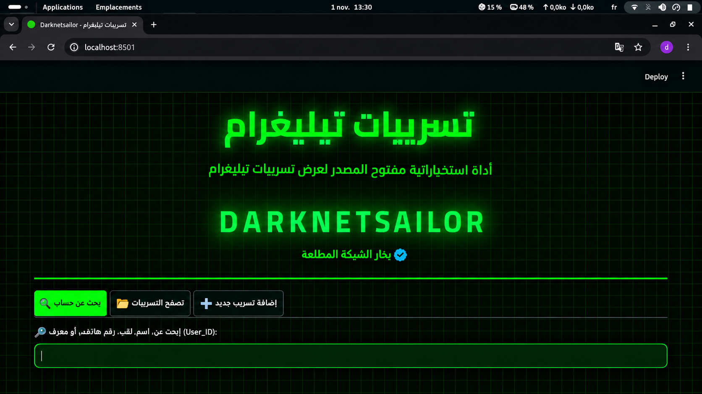
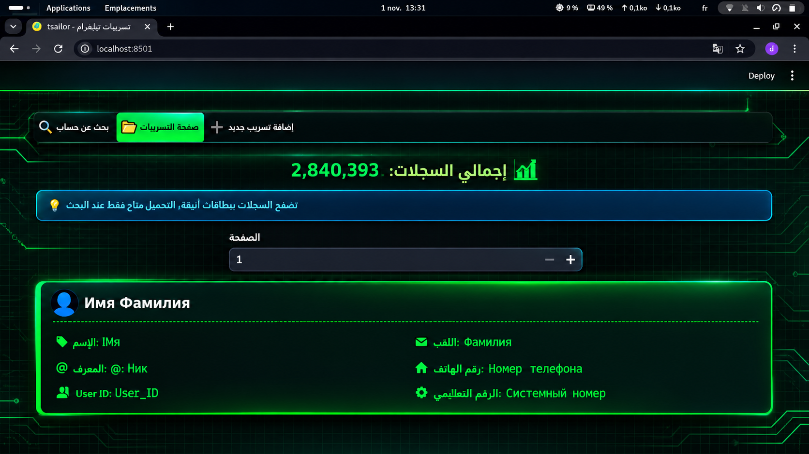
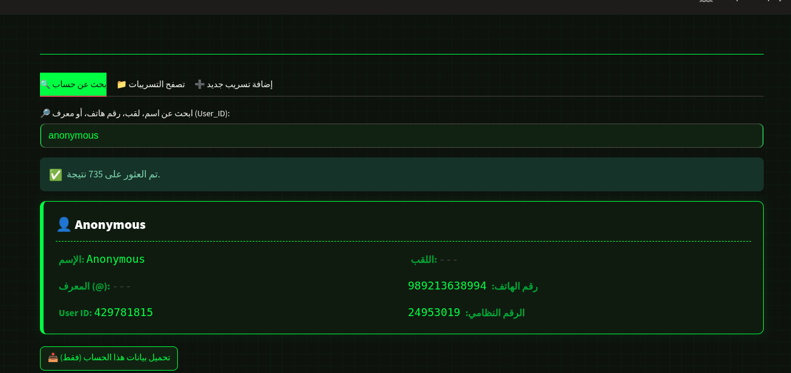

# 🛰️ Darknetsailor Telegram OSINT

<p align="center">
  
</p>

<p align="center">


</p>

---

# 🚀 نبذة عن المشروع

**Darknetsailor Telegram OSINT** هي أداة مفتوحة المصدر مبنية باستخدام **Python** و**Streamlit**، وتوفر واجهة عربية حديثة وسريعة للبحث داخل قواعد البيانات المحلية التي يملكها المستخدم، مع دعم البحث بعدة حقول وعرض النتائج بطريقة منظمة.

---

# ✨ المميزات

- 🔍 بحث سريع داخل قواعد البيانات المحلية.
- 👤 البحث بالاسم.
- 📱 البحث برقم الهاتف.
- 🆔 البحث بمعرف المستخدم.
- 📝 البحث باللقب (Username).
- 📄 تصدير نتائج البحث بصيغة CSV.
- ⚡ أداء سريع مع الملفات الكبيرة.
- 🌙 واجهة عربية حديثة مستوحاة من بيئات الأمن السيبراني.
- 🐍 مبنية باستخدام Python و Streamlit.
- 🔓 مفتوحة المصدر.

---

# 📸 صور الأداة

## 🏠 الصفحة الرئيسية


---

## 🔍 واجهة البحث



---

## 📄 النتائج



---

# ⚙️ التثبيت

استنسخ المشروع:

```bash
git clone https://github.com/darknetsailorpro-droid/darknetsailor-telegram-osint.git
```

ادخل إلى مجلد المشروع:

```bash
cd darknetsailor-telegram-osint
```

أنشئ البيئة الافتراضية:

```bash
python3 -m venv venv
```

فعّل البيئة الافتراضية:

```bash
source venv/bin/activate
```

ثبّت المتطلبات:

```bash
pip install -r requirements.txt
```

---

# ▶️ تشغيل الأداة + upgrade bottleneck

```bash
streamlit run app.py

pip install --upgrade bottleneck

```
بعد تشغيل الأداة افتح المتصفح على 

```
http://localhost:8501
```

---

# 📂 هيكل المشروع

```text
darknetsailor-telegram-osint/
│
├── app.py
├── README.md
├── requirements.txt
├── .gitignore
│
├── images/
│   ├── home.png
│   ├── search.png
│   └── add-record.png
│
└── assets/
```

---

# ⚠️ إخلاء مسؤولية

هذه الأداة مخصصة للأغراض التعليمية والبحثية فقط، ولتحليل البيانات التي يملكها المستخدم أو لديه تصريح قانوني باستخدامها.

يتحمل المستخدم وحده مسؤولية الالتزام بجميع القوانين والأنظمة المعمول بها عند استخدام هذه الأداة.

---

# ❤️ المساهمة

نرحب بجميع المساهمات، بما في ذلك:

- تحسين الأداء.
- إصلاح الأخطاء.
- اقتراح ميزات جديدة.
- إرسال Pull Requests.
- فتح Issues للإبلاغ عن المشاكل.

---

# ⭐ دعم المشروع

إذا أعجبك المشروع فلا تنسَ:

- ⭐ وضع نجمة (Star) للمستودع.
- 🍴 عمل Fork للمشروع.
- 💙 مشاركة المشروع مع المهتمين بمجال الأمن السيبراني.

---

# 👨‍💻 المطور

**Darknetsailor-PRO**

### 🌐 GitHub

https://github.com/darknetsailorpro-droid

### ▶️ YouTube

https://youtube.com/@darknetsailorpro-o1l?si=WLlal8o8pquf7PTF

---

<p align="center">
Made with ❤️ by <strong>Darknetsailor-PRO</strong>
</p>
